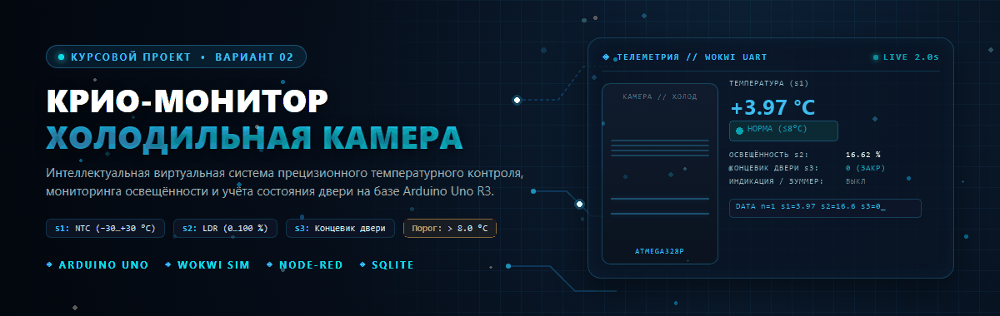
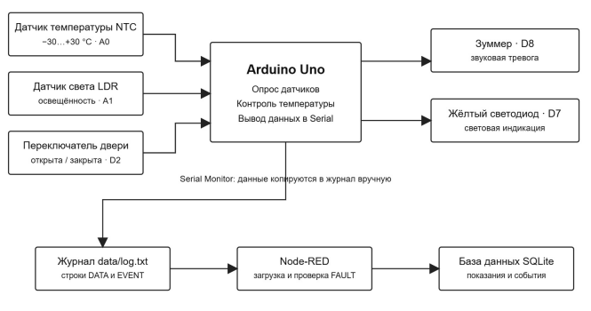
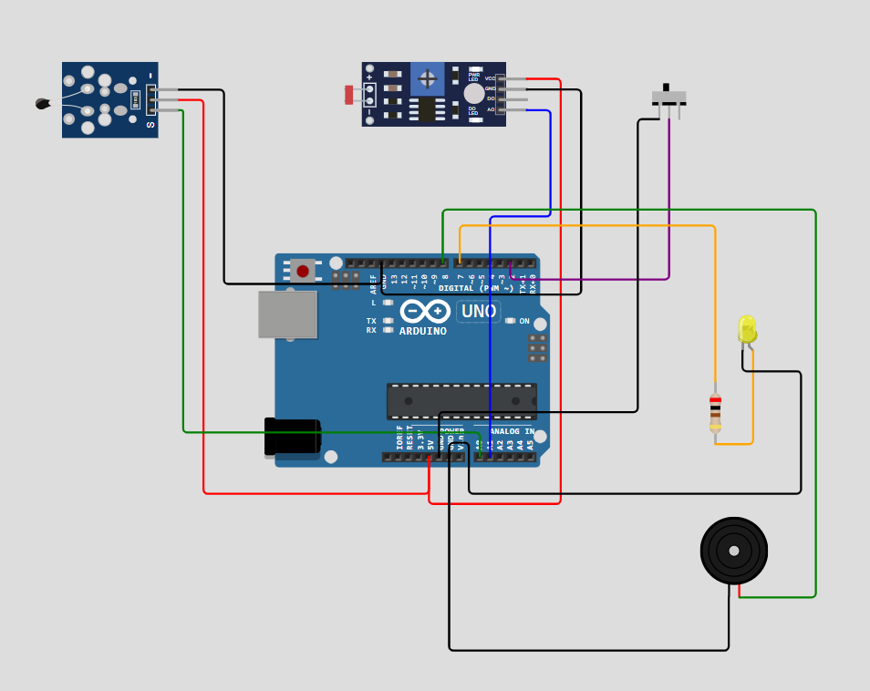
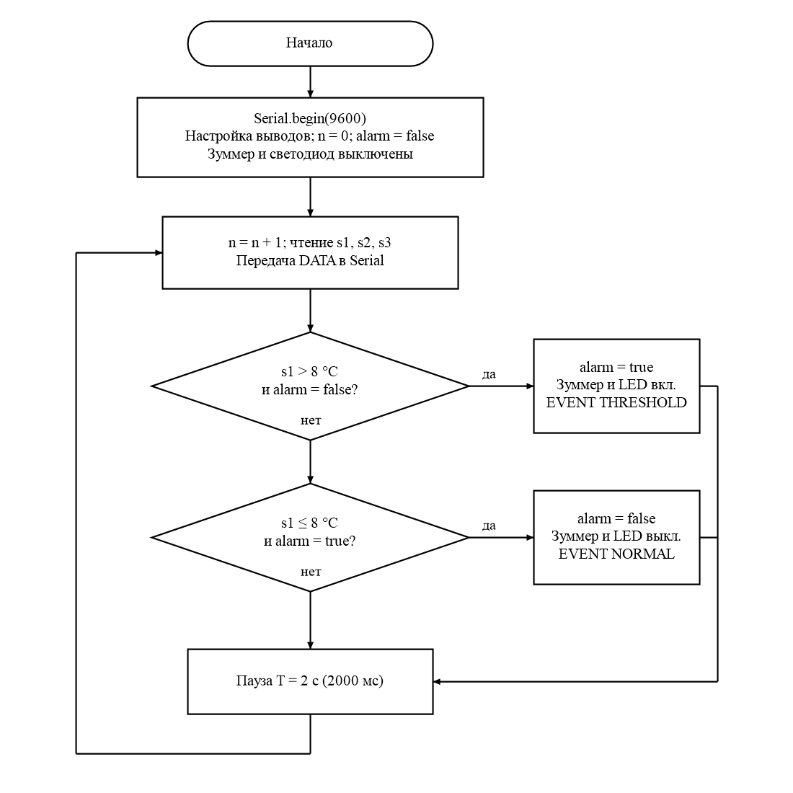
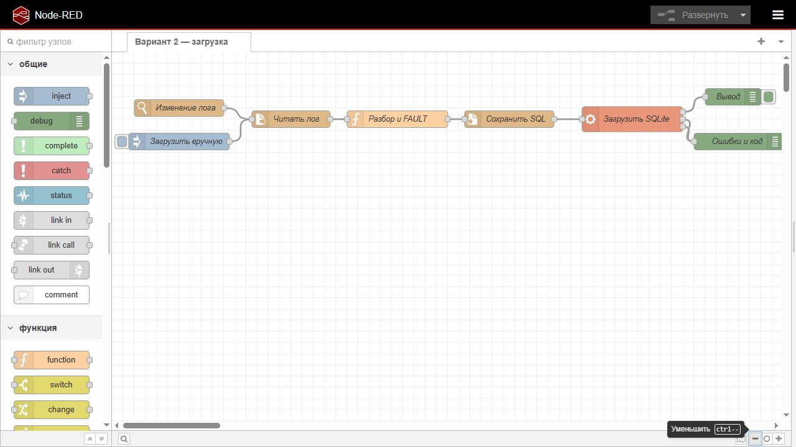
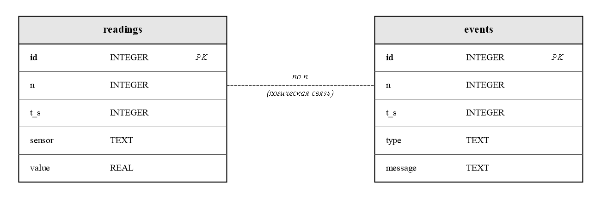
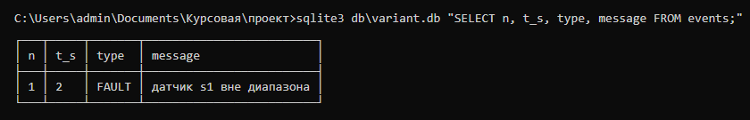

<div align="center">



# ❄️ КРИО-МОНИТОР
### Прецизионная система мониторинга и учёта микроклимата холодильной камеры

[](https://www.arduino.cc/)
[](https://wokwi.com/projects/479210672741778433)
[](https://nodered.org/)
[](https://www.sqlite.org/)
[](docs/schematic.pdf)
[-f59e0b?style=for-the-badge)](#)

<p align="center">
  <b>СПб ГБПОУ «Петровский колледж» • Отделение информационных технологий</b><br>
  Специальность 09.02.08 «Интеллектуальные интегрированные системы» • 2026 г.<br>
  <i>Выполнил:</i> <b>Боднар Михаил Дмитриевич</b> (группа 54-15) &nbsp;|&nbsp; <i>Руководитель:</i> <b>Борисов Егор Николаевич</b>
</p>

[🎮 Онлайн-симуляция в Wokwi](https://wokwi.com/projects/479210672741778433) • [⚡ Схемотехника ЕСКД](docs/schematic.pdf) • [📊 База данных](#-хранилище-данных-sqlite-и-аналитика) • [🚀 Быстрый запуск](#-руководство-по-быстрому-запуску)

---

</div>

## 📌 Инженерный замысел и спецификация варианта

Проект посвящён созданию аппаратно-программного комплекса непрерывного температурного контроля и диагностики холодильной камеры (*Вариант №2*), предназначенной для хранения скоропортящихся пищевых продуктов, биологических материалов и медицинских препаратов.

Нарушение режима хранения вследствие отказа компрессора или неплотно закрытой двери приводит к порче содержимого. Комплекс обеспечивает непрерывный съём телеметрии, местную световую и звуковую сигнализацию при выходе за пределы температурной нормы, автоматическую фильтрацию недостоверных отсчётов и долговременный статистический учёт в базе данных.

### 🎯 Тактико-технические характеристики варианта №2

| Канал / Узел | Тип и компонент | Диапазон / Номинал | Назначение в системе | Вывод Arduino |
|---|---|---|---|:---:|
| **Канал $s_1$** | NTC-термистор 10 кОм ($B = 3950$ К) | $-30 \dots +30$ °C | Контроль температуры камеры (физическая $\beta$-модель) | `A0` |
| **Канал $s_2$** | Фоторезистор GL5528 (LDR) | $0 \dots 100$ % | Измерение относительного уровня освещённости | `A1` |
| **Канал $s_3$** | Тумблерный концевик SPDT | `0` (закр.) / `1` (откр.) | Контроль положения двери камеры (`INPUT_PULLUP`) | `D2` |
| **Индикатор** | Жёлтый светодиод (LED3MMYELLOW) | $I_{\text{ном}} = 15$ мА | Световое оповещение превышения температурного порога | `D7` ($R_1 = 200$ Ом) |
| **Зуммер** | Пьезоизлучатель KMTG1740D | $f = 1000$ Гц | Акустическая сигнализация аварийного режима | `D8` (`tone`) |
| **Период $T$** | Неблокирующий таймер `millis()` | $T = 2.0$ с ($2000$ мс) | Фиксированный период дискретизации без дрейфа | — |
| **Порог** | Логический компаратор | $s_1 > 8.0$ °C | Срабатывание местной тревоги и фиксация `THRESHOLD` | — |

---

## 🗂️ Структурная схема системы

Архитектура комплекса разделена на аппаратно-имитационный уровень (микроконтроллер **Arduino Uno** в среде Wokwi с датчиками и исполнительными органами) и уровень обработки данных на ПК (конвейер **Node-RED** и СУБД **SQLite**).

<div align="center">



*Чертёж структурной схемы системы КП.5415.03.02 Э1 по ГОСТ 2.701-2008*

</div>

---

## ⚡ Схемотехнические решения и расчёты

Электрическая принципиальная схема спроектирована в САПР **EasyEDA** в соответствии со стандартами Единой системы конструкторской документации (**ГОСТ 2.701-2008**, **ГОСТ 2.710-81**). Делитель фоторезистора включён по схеме: $+5\text{V} \to R_3\,(10\text{ кОм}) \to \text{A1} \to R_4\,(\text{GL5528}) \to \text{GND}$, что обеспечивает согласование с физической моделью Wokwi и формулой прошивки: $s_2 = (1023 - N_{\text{АЦП}}) \cdot 100 / 1023$.

### 📐 Инженерные расчёты:

1. **Токоограничивающий резистор индикаторного светодиода ($R_1$):**
   При номинальном уровне порта $U_{\text{пит}} = 5.0$ В, прямом падении на жёлтом светодиоде $U_f = 2.1$ В и токе $I_{\text{ном}} = 15$ мА:
   $$R_{\text{расч}} = \frac{U_{\text{пит}} - U_f}{I_{\text{ном}}} = \frac{5.0 - 2.1}{0.015} = 193.33 \text{ Ом} \xrightarrow{\text{Ряд Е24}} R_1 = 200 \text{ Ом}$$
   *Фактический рабочий ток:*
   $$I_{\text{факт}} = \frac{5.0 - 2.1}{200} = 14.5 \text{ мА}$$
   *Рассеиваемая мощность:* $P_{R1} = I_{\text{факт}}^2 \cdot R_1 = 0.0145^2 \cdot 200 \approx 0.042$ Вт (более чем двукратный запас для резисторов типоразмера SMD 0603 мощностью $0.125$ Вт).

2. **Шаг квантования АЦП и пограничный анализ точки $8.0$ °C:**
   * Шаг квантования 10-разрядного АЦП по напряжению: $\Delta U = 5.0 / 1024 \approx 4.88$ мВ/МЗР.
   * Физическая модель терморезистора NTC по уравнению Стейнхарта–Харта ($\beta = 3950$ К, $T_0 = 298.15$ К):
     $$s_1 = \frac{1}{\frac{1}{\beta} \cdot \ln\left(\frac{1}{\frac{1023}{N_{\text{АЦП}}} - 1}\right) + \frac{1}{T_0}} - 273.15$$
   * При коде $N_{\text{АЦП}} = 707$ расчётное значение составляет $s_1 = 7.92$ °C (условие $s_1 > 8.0$ не выполняется, статус `NORMAL`).
   * При переходе на 1 МЗР к коду $N_{\text{АЦП}} = 706$ температура равна $s_1 = 8.01$ °C (срабатывание компаратора тревоги `THRESHOLD`).
   * Локальная дискретность шкалы вблизи порога составляет $\Delta T(8 \text{ °C}) \approx 0.0915$ °C на шаг АЦП.

3. **Информационный объём хранилища данных:**
   * Количество циклов опроса за 1 сутки при $T = 2$ с: $K_{\text{сут}} = 86\,400 / 2 = 43\,200$ циклов.
   * Суточное число записей по 3 каналам: $N_{\text{сут}} = 43\,200 \times 3 = 129\,600$ строк.
   * При среднем размере записи $\approx 40$ байт:
     * Суточный объём БД: $V_{\text{сут}} = 129\,600 \times 40 = 5\,184\,000 \text{ байт} \approx 5.18 \text{ МБ}$;
     * Объём данных за 30 суток: $V_{30} = 5.184 \times 30 \approx 155.52 \text{ МБ}$.

📄 **Конструкторская документация:**
* [Схема электрическая принципиальная и перечень элементов (PDF, ГОСТ)](docs/schematic.pdf)
* [Спецификация компонентов Bill of Materials (BOM CSV)](docs/bom.csv)

---

## ⚙️ Модель в Wokwi и алгоритм микроконтроллера

Интерактивная виртуальная модель собрана в симуляторе Wokwi:  
👉 **[Запустить интерактивную модель в Wokwi](https://wokwi.com/projects/479210672741778433)**

<div align="center">



*Монтажная схема соединений в среде симуляции Wokwi*

</div>

### 🧩 Алгоритм управляющей программы (`firmware/variant_02.ino`)

Прошивка реализует неблокирующий опрос датчиков через системный таймер `millis()`, исключая накопление временного дрейфа от задержек АЦП и UART. При переходе температуры через порог $8.0$ °C формируется **одиночное** событие `THRESHOLD`, а при охлаждении — `NORMAL` (повторные спам-сообщения при неизменном статусе подавляются).

<div align="center">



*Блок-схема циклического алгоритма опроса датчиков и управления сигнализацией*

</div>

---

## 🔄 Потоковый конвейер Node-RED

Среда потокового программирования **Node-RED** производит разбор строк UART, валидацию физических диапазонов и транзакционную запись в SQLite.

<div align="center">



*Конвейер приёма, синтаксического разбора и контроля диапазонов в Node-RED*

</div>

### Спецификация протокола UART (9600 бод):
* `DATA n=<целое> s1=<температура> s2=<освещенность> s3=<дверь>` — каждые $T = 2.0$ с. Пример: `DATA n=1 s1=3.97 s2=16.62 s3=0`
* `EVENT n=<целое> type=THRESHOLD | NORMAL` — однократно при смене статуса сигнализации. Пример: `EVENT n=9 type=THRESHOLD`

### Логика узла «Разбор и FAULT»:
* Снятие маркера последовательности байтов UTF-8 BOM (`\uFEFF`);
* Парсинг пар `ключ=значение`, проверка целочисленности номера цикла $n \ge 1$ и расчёт метки времени $t_s = n \cdot 2$;
* Контроль физических границ: $s_1 \in [-30; 30]$ °C, $s_2 \in [0; 100]$ %, $s_3 \in [0; 1]$;
* Формирование события неисправности `FAULT` при обнаружении аномальных показаний;
* Оборачивание всего пакета строк в атомарную транзакцию `BEGIN; DELETE FROM readings; DELETE FROM events; ... COMMIT;` для обеспечения полной идемпотентности загрузки.

---

## 🗄️ Хранилище данных SQLite и аналитика

База данных хранится в локальном файле `db/variant.db` и состоит из двух нормализованных таблиц, логически связанных по номеру цикла $n$:

<div align="center">



*Инфологическая модель реляционной базы данных (таблицы readings и events)*

</div>

### Контрольные аналитические SQL-запросы (`db/queries.sql`):

```sql
-- 1. Выборка 10 последних полученных отсчётов телеметрии:
SELECT * FROM readings ORDER BY id DESC LIMIT 10;

-- 2. Статистические показатели (минимум, среднее, максимум) по каждому каналу:
SELECT sensor, 
       ROUND(MIN(value), 2) AS min_value, 
       ROUND(AVG(value), 2) AS avg_value, 
       ROUND(MAX(value), 2) AS max_value
FROM readings 
GROUP BY sensor;

-- 3. Хронологический журнал всех зафиксированных тревог и сбоев:
SELECT t_s, type, message FROM events ORDER BY t_s, id;
```

---

## 🧪 Проверка неисправности (FAULT Injection)

Для верификации диагностического контура подготовлен синтетический журнал `data/log_fault.txt` с искусственно завышенной температурой $s_1 = 40.0$ °C (при допустимом диапазоне камеры $-30 \dots +30$ °C):
```text
DATA n=1 s1=40 s2=16.62 s3=0
```

При подаче файла в поток Node-RED в таблице `events` автоматически регистрируется аварийное событие:

<div align="center">



</div>

```text
┌───┬─────┬───────┬─────────────────────────┐
│ n │ t_s │ type  │ message                 │
├───┼─────┼───────┼─────────────────────────┤
│ 1 │ 2   │ FAULT │ датчик s1 вне диапазона │
└───┴─────┴───────┴─────────────────────────┘
```

---

## 🚀 Руководство по быстрому запуску

Проект полностью автономен и не требует глобальной установки Node.js или внешних утилит (портативный Node.js 26 размещён в каталоге `tools/`).

### 1. Запуск потока Node-RED
Запустите командный файл:
```bat
start-nodered.bat
```
Откройте браузер по адресу: [http://127.0.0.1:1880](http://127.0.0.1:1880).

### 2. Сбор журнала в симуляторе Wokwi
1. Перейдите в проект [Wokwi Variant 2](https://wokwi.com/projects/479210672741778433) и запустите симуляцию.
2. Проверьте отработку пороговой температуры (ползунок NTC выше 8 °C включает зуммер и жёлтый LED).
3. Скопируйте строки из окна **Serial Monitor** в файл `data/log.txt` и сохраните его.

### 3. Автоматическая загрузка и проверка данных
Поток автоматически перехватит сохранение файла через узел `watch` и выполнит скрипт `db/load.js`. Для прямой проверки базы данных выполните:
```bat
sqlite3 -header -column db\variant.db ".read db\queries.sql"
```
*(или через системный загрузчик: `node db/load.js`)*

---

## 📁 Файлы проекта

```
├── firmware/
│   └── variant_02.ino         # Исходный код прошивки Arduino Uno (C++)
├── sim/
│   └── diagram.json           # Описание схемы и соединений симулятора Wokwi
├── nodered/
│   ├── flow.json              # Конфигурация конвейера обработки данных
│   └── runtime/               # Локальные настройки и кэш среды Node-RED
├── db/
│   ├── schema.sql             # DDL-схема таблиц readings и events
│   ├── queries.sql            # Контрольные аналитические SQL-запросы
│   ├── load.js                # Сценарий загрузки на базе node:sqlite
│   └── variant.db             # Локальная база данных SQLite
├── data/
│   ├── log.txt                # Штатный журнал показаний Serial Monitor
│   └── log_fault.txt          # Тестовый журнал для эмуляции отказа датчика
├── docs/
│   ├── banner.png             # Фирменный графический баннер проекта
│   ├── structure.png          # Настоящая структурная схема системы
│   ├── scheme.png             # Настоящая схема сборки Wokwi
│   ├── algorithm.png          # Блок-схема алгоритма программы МК
│   ├── er.png                 # ER-диаграмма базы данных SQLite
│   ├── nodered-flow.png       # Скриншот потока обработки в Node-RED
│   ├── fault-test.png         # Консольный скриншот проверки события FAULT
│   ├── schematic.pdf          # Документация ЕСКД (Э3 и ПЭ3 по ГОСТ)
│   └── bom.csv                # Перечень элементов спецификации
├── tools/                     # Портативная среда Node.js 26 и модули
└── start-nodered.bat          # Скрипт быстрого запуска Node-RED
```

---

<div align="center">
  <sub>Разработано в рамках курсового проектирования по ПМ.02 / МДК.02.01 • СПб ГБПОУ «Петровский колледж» • 2026</sub>
</div>
